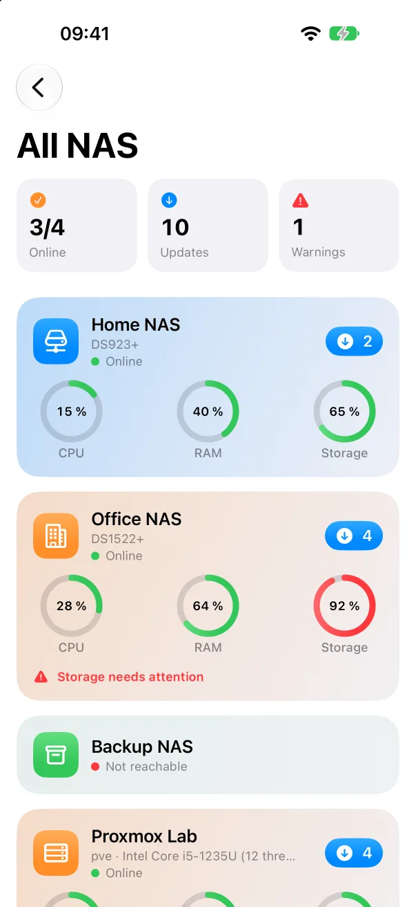
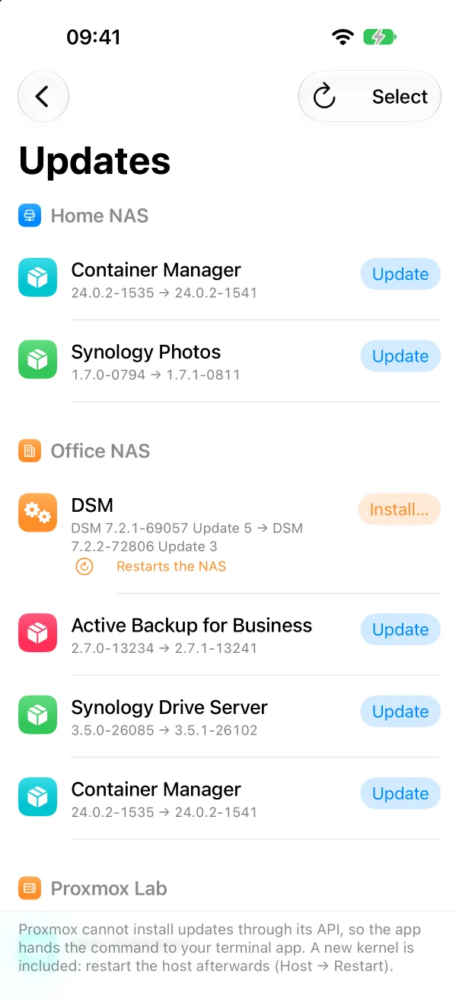
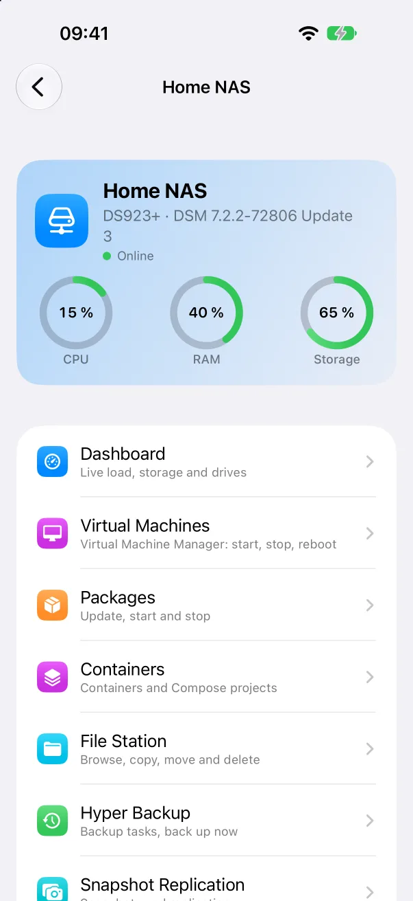
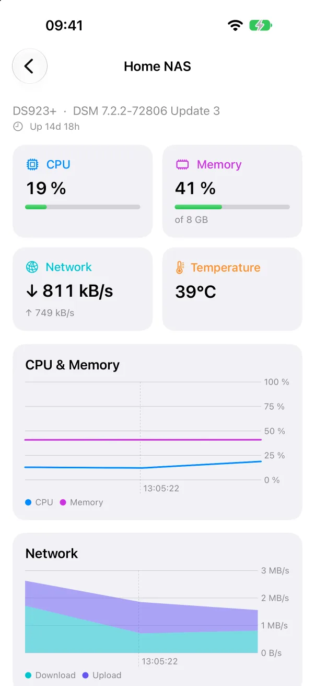

<h1 align="center">NAS Cockpit</h1>

<p align="center">
  <b>All your Synology NAS and Proxmox hosts – and all their updates – in one native app.</b><br>
  iPhone &amp; iPad · iOS 26 · Swift 6 &amp; SwiftUI · no tracking · no third-party dependencies
</p>

<p align="center">
  
  
  
  
</p>

> **Unofficial app.** NAS Cockpit is an independent project, not affiliated with or endorsed by Synology Inc. or
> Proxmox Server Solutions GmbH.

## 💡 Why

I do a lot of my homelab admin from the iPad and the iPhone – and neither Synology nor Proxmox offers a decent app
for that. On a touch screen, the DSM and Proxmox web interfaces are fiddly: tiny controls, zooming in and out, and
signing in to each server separately just to see whether something needs an update or a backup failed.

So I built the app I was missing. NAS Cockpit puts all servers on one screen – status, updates, containers, backups
and logs, across every server at once. Native, free, without accounts or analytics, and with a security model that is
written down instead of hidden.

## ✨ Features

**Across all servers**

- 🖥️ **One overview** – CPU, RAM and storage of every server, warnings at a glance
- ⬇️ **All updates in one list** – packages, DSM and Proxmox host updates; multi-select and install in one go
  (sequential per server, parallel across servers)
- 🔔 **Notifications** – opt-in background refresh reports storage problems, new updates, crashed containers and
  failed backups; plus DSM's own notification inbox for all servers
- 🧩 **Widgets** – server status and open updates on the Home Screen
- ⏰ **Wake-on-LAN** – wake a sleeping server and reconnect automatically
- ☁️ **iCloud sync** – servers sync through your own private iCloud, end-to-end encrypted; passwords never leave
  the device

**Synology DSM 7.2+**

- Live dashboard: load, network, temperature, volumes and drives
- Package Center: update, start, stop · DSM updates with restart handling
- Container Manager: containers and Compose projects, logs
- File Station: browse, copy, move, create folders, delete
- Hyper Backup: tasks, destination status, *Back Up Now* · Snapshot Replication
- Security Advisor: result of the last scan per category, failed checks, *Scan Now* with live progress
- Virtual Machine Manager, Control Panel (users, SSH, update policy, restart/shutdown), logs by source

**Proxmox VE**

- Sign in with password + TOTP, API token or OpenID Connect (passkeys work)
- VMs and containers across the cluster: start, shut down, stop, reboot, snapshots
- vzdump backup jobs with *Back Up Now*, host updates, journal and sign-in logs
- *Open Shell* hands host or guest over to your terminal app (WebSSH, Termius, Blink, Prompt …)

## 🔒 Security

NAS admin credentials are about as sensitive as it gets, so security is a core goal, not an afterthought:

- **Certificate pinning** (SPKI, trust on first use) – self-signed certificates work without disabling TLS checks
- **Keychain only** – passwords, API tokens and 2FA device tokens stay on the device (`ThisDeviceOnly`)
- **Face ID** for destructive actions (restart, shutdown, delete, disable user) – independent of the optional app lock
- **HTTP only inside your network** – plain HTTP is refused for public hosts; use a VPN (WireGuard, Tailscale) on the go
- **No QuickConnect, no relay, no analytics** – the app only ever talks to your own servers
- Writes are never retried automatically, so a flaky connection cannot run an action twice

## 🚧 Status

NAS Cockpit is in active development and not yet on the App Store. Many DSM and Proxmox endpoints are built from the
official API guides and open-source clients but are still marked `UNVERIFIED` in the code until they have been tested
against real hardware. Reports from your own DSM or PVE setup are very welcome – see the
[technical notes](docs/TECHNICAL.md) for what still needs checking and the [roadmap](ROADMAP.md) (German) for what's next.

## 🚀 Build it yourself

You need Xcode 26 or later. There are no third-party dependencies.

```bash
git clone https://github.com/RainerZufall00/NASCockpit.git
cd NASCockpit
cp Config/Secrets.example.xcconfig Config/Secrets.xcconfig   # set DEVELOPMENT_TEAM to run on a device
open NASCockpit.xcodeproj
```

The simulator build works without a team ID. Tap **Try the Demo** on the first screen to explore the app with sample
servers. Details for contributors are in [CONTRIBUTING.md](CONTRIBUTING.md).

## ☕ Support

NAS Cockpit is free, without ads or subscriptions. If it saves you a few logins every week, you can buy me a coffee:

<a href="https://buymeacoffee.com/rainerzufall00">
  
</a>

## License

Code: [MIT License](LICENSE). The name **NAS Cockpit** and the app icon are not covered – if you publish your own
build, please use a different name and icon. *Synology*, *DSM*, *Hyper Backup* and related names are trademarks of
Synology Inc. *Proxmox* is a trademark of Proxmox Server Solutions GmbH.
